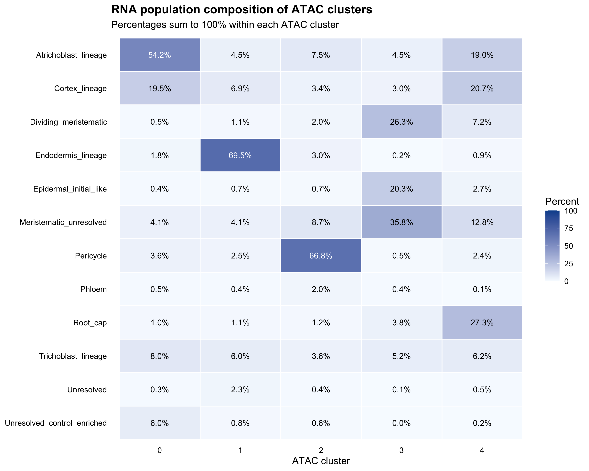
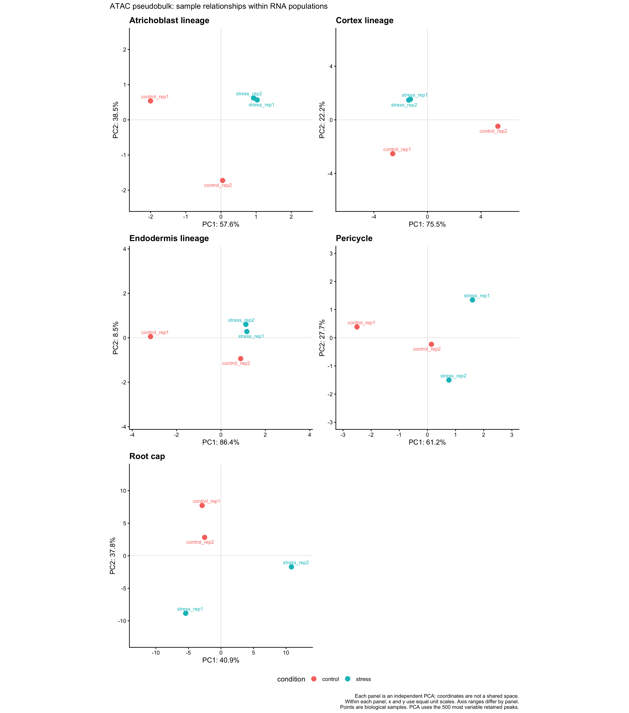
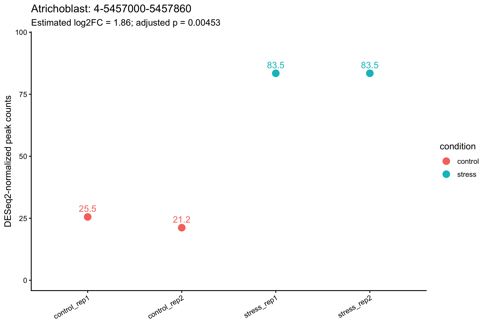

# Project 3 — Core 2: ATAC and paired-nucleus RNA context

[Project overview](../../README.md) · [Core 1: corrected RNA](../core1/README.md) · [Final project scope](../../docs/project_scope.md)

**Status: analysis completed; assembled downstream workflow manually rerun and matched; pending user review before commit/push.**
This is an independent training reanalysis, not a numerical reproduction of the original study.

## Questions and findings

We asked whether osmotic stress changes chromatin accessibility within RNA-defined root populations, and whether nearby accessibility changes add context to the 137 Project 1 interaction candidates.

- Four original peak lists were reduced to **27,677 common nuclear intervals** and recounted from reconstructed fragments. Interval coordinates are shared; their widths need not be equal, and a region need not be open in all samples.
- ATAC QC plus exact-nucleus corrected RNA QC/singlet pairing retained **14,146 nuclei**: 1,239 / 3,817 / 4,841 / 4,249 in control 1 / control 2 / stress 1 / stress 2.
- Five ATAC clusters have provisional, sometimes mixed RNA compositions. Same-nucleus barcode matching, RNA identity overlays, cluster composition and marker-region checks are already the RNA–ATAC joint comparison in this core.
- Five population-level, four-sample pseudobulk comparisons identified **one peak at within-population FDR <0.05**, in Atrichoblast_lineage. Its estimated stress/control log2FC is 1.860 and adjusted p is 0.004526. Both stress replicates exceed both controls at this region.
- Of 137 P1 candidates, 120 have a matching common peak under the fixed gene-body / TSS-nearby rule. **None has a matched peak passing the current population-level FDR criterion.** This is not a gene-level null result or evidence against their stress roles.
- Control 1's low-signal subgroup predates our recounting and is present in the published ATAC matrix. Independent recounting found no error in the checked metrics or matrix. The specific experimental cause remains unknown.

The result is limited biological evidence from a completed analysis, rather than a requirement to obtain many significant regions. We did not relax thresholds to increase discoveries, run new GO tests, infer a regulatory network or claim causal target genes.

## Results

| RNA population | Peaks in model | FDR <0.05 | Significant estimated ≥2-fold increase in stress |
| --- | ---: | ---: | ---: |
| Atrichoblast_lineage | 27,634 | 1 | 1 |
| Cortex_lineage | 27,384 | 0 | 0 |
| Endodermis_lineage | 25,508 | 0 | 0 |
| Pericycle | 23,757 | 0 | 0 |
| Root_cap | 2,487 | 0 | 0 |

The candidate interval is **chr4:5,457,000–5,457,860**, in one-based closed coordinates. Its BED counterpart is `4 5456999 5457860`. Standardized sample counts are approximately 25.5 / 21.2 / 83.5 / 83.5. AT4G08570 is the nearest annotated gene, with a minimum interval-to-TSS distance of 900 bp; proximity is not a validated regulatory link.

[Full conclusions and limits](../../docs/core2/analysis_story.md) · [Methods and parameters](../../docs/core2/methods.md) · [Control 1 review](../../docs/core2/control1_review.md) · [Decision trail](../../docs/core2/decision_log.md)

## Figures





Each population has an independent PCA. The axes use equal physical unit scales within each panel; positions across panels are not a shared coordinate system. PCA depicts biological samples, unlike the nucleus-level ATAC UMAP.



[Other main figures](../../results/core2/figures/) · [Result tables](../../results/core2/tables/) · [Diagnostic figures and provenance](../../results/core2/diagnostics/)

The full 59-marker dot plot is retained as a diagnostic, not presented as a main result. Gene-region signal is ATAC accessibility, not RNA expression. SCR coverage includes neighboring genes and does not make every peak in the displayed window an SCR regulatory region.

## Running and validation

```sh
Rscript scripts/run_core2.R help
```

Help runs no analysis. [Running instructions](../../docs/core2/running.md) separate existing-result inspection, local QC, optional upstream reconstruction and explicit downstream rebuild stages. Default downstream rebuild outputs are separate from the reviewed run. Raw reads, fragments, large matrices and RDS checkpoints are not in Git.

Earlier interactive downstream steps have now been reconstructed as callable scripts. Syntax, synthetic selection/count-alignment checks, saved-result consistency and saved-coordinate figure rendering were checked. **The user has now rerun the assembled downstream workflow in RStudio from four existing unfiltered QC objects. All ten comparisons matched the recorded run, with differential-statistic tolerance 1e-7. Upstream reconstruction and QC metric recalculation were not repeated.** See [validation scope](../../docs/core2/validation.md).

## Interpretation boundary

There are two biological replicates per condition. Nuclei are not independent biological replicates. Cluster labels remain provisional; several clusters are mixed. Root_cap has weak within-condition reproducibility and is exploratory. BH correction is within each population, not jointly across five populations. Estimated fold-change prioritization is separate from a test against a nonzero fold-change threshold. Failure to reject the null does not establish absence of stress responses.

The paired subset has fewer nuclei than Core 1's RNA-only analysis; the difference follows ATAC and paired-eligibility filters. No separate Core 3 is required to repeat the paired comparison already performed here.
